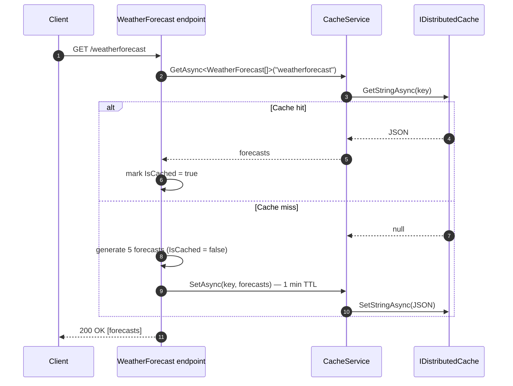

# CacheHub

> A small, focused .NET 10 Minimal API that shows the **cache-aside pattern** with `IDistributedCache`. It wraps caching in one reusable `ICacheService`, discovers endpoints automatically through an `IEndPoint` convention, and works as a template for adding caching to any ASP.NET Core API.


---

## Table of contents

1. [Business overview](#1-business-overview)
2. [Features](#2-features)
3. [Architecture](#3-architecture)
4. [Design patterns](#4-design-patterns)
5. [Technology stack](#5-technology-stack)
6. [Project structure](#6-project-structure)
7. [How it works](#7-how-it-works)
8. [Getting started](#8-getting-started)
9. [API reference](#9-api-reference)
10. [Switching to Redis](#10-switching-to-redis)
11. [Development workflow](#11-development-workflow)
12. [Roadmap](#12-roadmap)

---

## 1. Business overview

APIs often recompute or re-fetch the same data on every request: reference data, reports, forecasts, product lists. That costs database time and slows responses. **Caching** keeps a copy of recent results so repeated requests are answered at once.

CacheHub is a **reference implementation** for teams that want to:

- add caching to an API **without spreading cache code across every endpoint**;
- start with an **in-memory** distributed cache in development and move to **Redis** in production by changing a single registration;
- **invalidate** a single entry or a whole group of entries (by key prefix) when the data changes.

---

## 2. Features

| Feature | Description |
|---|---|
| Generic cache service | `GetAsync<T>`, `SetAsync<T>`, `RemoveAsync`, `RemoveByPrefixAsync` |
| Cache-aside helper | `GetAsync<T>(key, factory)` returns the cached value, or runs the factory and caches the result |
| Expiration | Entries expire after **1 minute** (absolute expiration) |
| Prefix invalidation | Keys are tracked in memory, so related entries can be removed together (for example `orders:*`) |
| Cache visibility | The weather endpoint marks each item with `IsCached`, so you can watch hits and misses |
| Endpoint auto-discovery | Any class that implements `IEndPoint` is registered and mapped automatically |
| OpenAPI | The API document is published in Development |

---

## 3. Architecture

```mermaid
flowchart LR
    C[HTTP client] --> EP

    subgraph API["CacheHub (ASP.NET Core Minimal API)"]
        EP["Endpoints<br/>WeatherForecastEndPoints<br/>OrderEndPoints (IEndPoint)"]
        CS["ICacheService<br/>CacheService"]
        KEYS["Key registry<br/>ConcurrentDictionary"]
        EP --> CS
        CS --> KEYS
    end

    CS --> DC[("IDistributedCache<br/>In-memory today · Redis tomorrow")]
    EP -.cache miss.-> SRC["Data source<br/>(generated data / database)"]
```



The application is a single project with a clear separation of concerns:

| Folder | Responsibility |
|---|---|
| `Configuration/` | Service registration (`AddServices`) and explicit endpoint mapping |
| `EndPoints/` | Route definitions. `Interfaces/IEndPoint` is the discovery contract, and `Extensions/` holds the scanning and mapping logic. |
| `Services/` | `ICacheService` and its implementation over `IDistributedCache` |
| `Model/` | Data transfer objects |

---

## 4. Design patterns

| Pattern | Where | Why |
|---|---|---|
| **Cache-aside (lazy loading)** | `CacheService.GetAsync(key, factory)`, `WeatherForecastEndPoints` | Load from the cache first; on a miss, load from the source and fill the cache. |
| **Facade / service abstraction** | `ICacheService` | Hides serialization, expiry and key tracking behind a simple, typed API. |
| **Dependency inversion** | Endpoints depend on `ICacheService`, the service on `IDistributedCache` | The cache backend (memory, Redis, SQL) can change without code changes. |
| **Convention-based registration** | `EndPointExtension.AddApplicationEndPoints` | Assembly scanning registers every `IEndPoint`, so new endpoint files need no wiring. |
| **Extension-method composition** | `AddServices()`, `MapApplicationEndpoints()`, `MapEndPoints()` | Keeps `Program.cs` short and readable. |
| **Singleton service** | `CacheService` | One shared key registry for the whole process. |

---

## 5. Technology stack

| Area | Technology |
|---|---|
| Runtime | .NET 10, ASP.NET Core Minimal APIs |
| Caching | `Microsoft.Extensions.Caching.Distributed` (`AddDistributedMemoryCache`) |
| Serialization | Newtonsoft.Json 13 |
| API docs | `Microsoft.AspNetCore.OpenApi` |
| Tooling | `CacheHub.http` request file (Visual Studio / VS Code REST Client) |

---

## 6. Project structure

```text
CacheHub/
├── CacheHub.slnx
└── CacheHub/
    ├── Configuration/
    │   ├── ConfigureServices.cs            # Registers the distributed cache + ICacheService
    │   └── ConfigureApplicationEndPoints.cs# Maps explicitly registered endpoint groups
    ├── EndPoints/
    │   ├── Interfaces/IEndPoint.cs         # Discovery contract
    │   ├── Extensions/EndPointExtension.cs # Scans the assembly and maps every IEndPoint
    │   ├── WeatherForecastEndPoints.cs     # Cache-aside demo + cache removal
    │   └── OrderEndPoints.cs               # Auto-discovered endpoint example
    ├── Model/WeatherForecast.cs
    ├── Services/
    │   ├── Interfaces/ICacheService.cs
    │   └── CacheService.cs
    ├── Program.cs
    └── CacheHub.http
```

---

## 7. How it works

### Cache-aside flow (`GET /weatherforecast`)



### Try it yourself

1. Call `GET /weatherforecast`: every item has `"isCached": false` (a miss, so fresh data was generated).
2. Call it again within 1 minute: the same data comes back with `"isCached": true` (a hit).
3. Call `GET /removeWeatherforecastCache`: the entry is evicted.
4. Call `GET /weatherforecast` again: new data is generated (a miss).

---

## 8. Getting started

### Prerequisites

- [.NET 10 SDK](https://dotnet.microsoft.com/)

### Run

```bash
git clone https://github.com/tmadushan95/CacheHub.git
cd CacheHub
dotnet run --project CacheHub
```

| Profile | URL |
|---|---|
| http | `http://localhost:5093` |
| https | `https://localhost:7014` |

OpenAPI document (Development): `http://localhost:5093/openapi/v1.json`

You can also open `CacheHub/CacheHub.http` in Visual Studio or VS Code and send the requests from there.

---

## 9. API reference

| Method | Route | Description |
|---|---|---|
| `GET` | `/weatherforecast` | Returns 5 forecasts, served from the cache when available |
| `GET` | `/removeWeatherforecastCache` | Removes the `weatherforecast` cache entry |
| `GET` | `/allOrders` | Sample orders (shows endpoint auto-discovery) |

---

## 10. Switching to Redis

The service depends only on `IDistributedCache`, so moving to Redis is a configuration change:

```bash
dotnet add CacheHub package Microsoft.Extensions.Caching.StackExchangeRedis
```

```csharp
// Configuration/ConfigureServices.cs
services.AddStackExchangeRedisCache(options =>
{
    options.Configuration = configuration.GetConnectionString("Redis");
    options.InstanceName  = "CacheHub:";
});
```

> Note: the prefix-removal key registry lives **in process memory**. If you run several instances behind Redis, replace it with a Redis `SCAN`-based lookup or a Redis set of keys.

---

## 11. Development workflow

1. Create a branch: `git checkout -b feature/<name>`.
2. To add an endpoint, create a class in `EndPoints/` that implements `IEndPoint`. It is discovered automatically.
3. Inject `ICacheService` and use `GetAsync(key, factory)` for read-through caching. Call `RemoveAsync` or `RemoveByPrefixAsync` after writes.
4. Use descriptive, prefixed cache keys (`orders:{id}`, `orders:list`) so whole groups can be invalidated.
5. Run `dotnet build`, test with `CacheHub.http`, commit and open a pull request.

---

## 12. Roadmap

- [ ] Configurable expiration per call and from `appsettings.json`
- [ ] Redis provider wired in through configuration
- [ ] Use `ICacheService` in the orders endpoint (currently returns static data)
- [ ] Unit tests for `CacheService` and integration tests for the endpoints
- [ ] Move to `System.Text.Json` to drop the Newtonsoft dependency

---

**Author:** [tmadushan95](https://github.com/tmadushan95)
